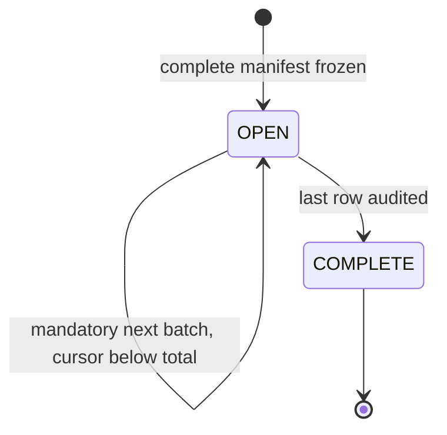

# AnnotationAuditConveyor

A permissionless, complete-coverage audit of a bounded published annotation dataset. Validators independently fetch the evidence behind every annotation, audit rows in mandatory batches, and maintain exact conservative error bounds including unresolved and unfinished items.

Live StudioNet: [`0xeACeD0F3067c02c545913c4658F61910544485B8`](https://explorer-studio.genlayer.com/address/0xeACeD0F3067c02c545913c4658F61910544485B8). [Seven finalized proofs](LIVE_PROOFS.md): four successful executions and three expected rejections. [Ready-to-fill submission](SUBMISSION.md).

Experimental GenLayer infrastructure. Not a truth oracle, approval certificate, service-delivery verifier, agent-alignment judge, financial score, graph engine or policy compiler.

## Problem and consensus boundary

An annotator can publish claims, evidence links and labels while selectively showcasing favorable examples. A reviewer cannot infer dataset quality from a few handpicked rows or from URL/hash existence. This contract freezes the **entire bounded manifest** and makes the next batch unavoidable. Every consequential observation is independently derived from the actual fetched source contents.

The provider's annotations are **the object being audited**, never trusted evidence. The model does not see them. Callers supply manifest coordinates, not statements, document bodies, observations, match decisions, counts, windows or confidence. The contract owns manifest acquisition, row ordering, source commitments, semantic consensus, exact label comparison, coverage and aggregation.

```mermaid
flowchart LR
 A[Published dataset manifest] --> B[Independent full-manifest acquisition]
 B --> C[Frozen ordered dataset root]
 C --> D[Contract selects next two rows]
 D --> E[Each validator fetches actual evidence bodies]
 E --> F[Independent semantic SUPPORT / REFUTE / UNKNOWN]
 F --> G[Exact complete-report consensus]
 G --> H[Compare against withheld provider annotations]
 H --> I[Append batch root; advance coverage; update bounds]
```



## Distinct architecture

Storage consists of frozen audit runs, immutable batch transcripts, a monotone exactly-once cursor, conserved counts and a hash-linked batch history. There are no graph nodes/edges, proposals, mutable owner-controlled heads, approval certificates, execution rights or consumption methods.

- Unlike `bounded-policy-compiler`, it does not compile hypothetical conditions into a function. It incrementally audits every item of a fixed external dataset.
- Unlike `normative-clause-index`, callers cannot choose favorable paragraph windows and it creates no inverted postings/search index. Coverage of the whole manifest is mandatory, including negative and unavailable results.
- Unlike a scoring oracle, it does not accept caller confidence or assign AI scores. Exact consistency counts and rational uncertainty bounds are deterministic consequences of independently observed labels.

Shared HTTP/signing helpers are infrastructure, not the substantive mechanism. Novelty here is **complete-run coverage accounting with honest unresolved denominators**, not a renamed source-verification certificate.

## Dataset format

`examples/dataset.json` has schema `annotation-dataset-v1` and 1–16 items. Each item has a unique ID, bounded statement, provider annotation `SUPPORT` or `REFUTE`, and a content-addressed evidence source. A source contains `owner`, `repo`, full 40-character `commit`, safe relative `.txt`/`.md` `path`, and exact lowercase SHA-256.

The contract constructs HTTPS URLs only under `raw.githubusercontent.com`; callers cannot choose arbitrary hosts or local paths. Manifest responses are at most 16 KiB; evidence bodies at most 4 KiB. Full bytes are hashed before interpretation, never truncated. Invalid UTF-8, HTTP errors, wrong commitments or oversized evidence become UNKNOWN. Exact duplicate item/source bindings are rejected even if labels/IDs differ; paraphrase or publisher bias is not automatically eliminated.

Source documents are committed first; the manifest then pins their actual commit. No placeholder references remain in the published dataset. Manifest source coordinates/hash and parsed row order are frozen at run creation.

## Public API and state transitions

`start_run(nonce, owner, repo, commit, path, expected_hash)` independently fetches and validates the whole `.json` manifest. Creator/contract/nonce binds the run ID. Failed acquisition/schema validation stores no run and consumes no nonce. Duplicate successful nonce use is rejected. At most 32 runs per creator per deployment.

`audit_next(run_id, expected_cursor)` is permissionless. The caller cannot select rows, skip ahead, reuse a prior batch or change batch size. The contract selects `[cursor, min(cursor + 2, total))`. It fetches each source independently, passes only valid acquired bodies and statements to semantic reasoning, and forces failed evidence to UNKNOWN.

Each validator refetches all selected evidence and independently derives the same complete observation vector. The full report—run, frozen root, previous head, cursor interval, counts before, IDs, source URLs/statuses/hashes/bodies and semantic labels—must match exactly. No tolerance exists. Post-consensus checks revalidate bindings, hashes, label types and failed-evidence consistency before any state change.

`MATCH` means observed SUPPORT/REFUTE equals the provider annotation; `MISMATCH` means a known opposite observation; `UNRESOLVED` means UNKNOWN. An annotation's existence cannot produce MATCH. Every successful batch appends an immutable transcript/root and advances exactly its fixed row count, even if documents were unavailable. A stale competing transaction reverts rather than double-counting.



COMPLETE means **coverage**, not approval. No creator veto, cancellation, reset, row deletion or reclassification exists. Malformed model output/disagreement fails closed with no cursor advance; any willing party can retry. There are no funds or jobs to lock. Permanent network/model failure can still prevent progress, and pending items remain fully represented in the bounds.

`get_run`, `get_batch(run_id, start)` and `summary(run_id, expected_head)` expose provenance. Summary readers must bind the exact current head; old summaries cannot silently represent newer coverage. A batch report is bound to its run and prior head, preventing cross-run substitution.

## Exact conservative bounds

For total `N`, observed mismatches `E`, unresolved `U` and pending `P`:

`error lower = E / N`; `error upper = (E + U + P) / N`.

These are **logical ranges for document-consistency error counts**, not statistical confidence intervals or claims about universal truth. They assume known consensus judgments are correct; shared model errors are not included in the range. Integer numerator/denominator pairs avoid rounding across thresholds. Conservation requires `MATCH + MISMATCH + UNRESOLVED + pending = N`. Unavailable or unaudited rows never disappear from the denominator.

The lower bound cannot decrease; the upper bound cannot increase as rows are audited. With no unresolved/pending items, the bounds coincide. Coverage applies only to this frozen manifest, not an unseen external dataset or provider's full population.

## Example and limitations

The authored fictional ingestion API reference rejects unauthenticated/empty submissions and documents HTTP 202 for success. Four annotations deliberately include one incorrect label and one wrong evidence hash. Expected full audit: 2 MATCH, 1 MISMATCH, 1 UNRESOLVED; error range 1/4–2/4. After the first batch, the range is 1/4–3/4 because two rows are still pending.

This proves independent document acquisition, semantic annotation checking and coverage accounting. It does **not** prove a live API behaves as documented, establish service delivery, verify agent behavior, authenticate a publisher's authority or assert independent sources. Hash pinning fixes a published revision, not current applicability. Source content may be false; shared model errors and prompt injection remain residual risks despite explicit data/instruction separation.

## Installation and tests

```powershell
python -m venv .venv
.venv\Scripts\pip install -r requirements-dev.txt
npm ci --ignore-scripts
.venv\Scripts\genvm-lint check contracts/AnnotationAuditConveyor.py
.venv\Scripts\python -m pytest tests -q
npm run test:sdk
```

38 tests cover permissionless coverage, exact bounds, stale/replayed/skipped cursors, head binding, cross-run separation, invalid manifest/source paths/labels/duplicates, incomplete evidence, odd final batches, malformed model output, withheld annotations, post-consensus tampering, maximum-size unavailable datasets and the actual validator callback. Bounds are checked exhaustively over 4,844 conserved states for dataset sizes 1–16. Direct mocks/callback tests are not distributed consensus proofs. The narrow Windows fixture defers only gltest's open-tempfile unlink issue.

## Deploy and interact

```powershell
npm install -g genlayer@0.39.2
genlayer network set studionet
genlayer account create --name audit-test
genlayer account use audit-test
genlayer account unlock
genlayer deploy --contract contracts/AnnotationAuditConveyor.py
genlayer schema CONTRACT_ADDRESS
```

StudioNet is gasless. Use a dedicated zero-balance test account and native encrypted-keystore/OS-vault signing; never export or publish private keys/passwords. The GenVM runner is concretely pinned on the first contract line. No funds are transferred.

For this repository's dedicated public test signer, set `AUDIT_TEST_ACCOUNT` and optionally `AUDIT_CLI_PATH`; run `node scripts/demo.mjs MODE ADDRESS MANIFEST_COMMIT`. Modes: `start`, `skip` (expected rejection), `first`, `replay` (expected rejection), `second`, `terminal` (expected rejection). Each sends only one documented transaction. `run-cli.cjs` hides raw receipts and deduplicates identical already-signed broadcasts. A network timeout is uncertain: inspect the known hash/history before any resend.

```powershell
node --dns-result-order=ipv4first scripts/check.mjs success TX_HASH
node --dns-result-order=ipv4first scripts/check.mjs error TX_HASH "Audit cursor mismatch"
node --dns-result-order=ipv4first scripts/check.mjs source CONTRACT_ADDRESS
node --dns-result-order=ipv4first scripts/check.mjs state CONTRACT_ADDRESS RUN_ID
```

Check FINALIZED **and** execution SUCCESS; finalized ERROR receipts are negative proofs, not successful audits. The state checker independently recomputes the frozen dataset, full response hashes, batch chain, verdicts, counts and exact bounds. Explorer links use `https://explorer-studio.genlayer.com/address/ADDRESS` and `/tx/HASH`. [LIVE_PROOFS.md](LIVE_PROOFS.md) records real verified transactions when published; [SUBMISSION.md](SUBMISSION.md) provides portal text. No independent security audit or acceptance guarantee is claimed.
